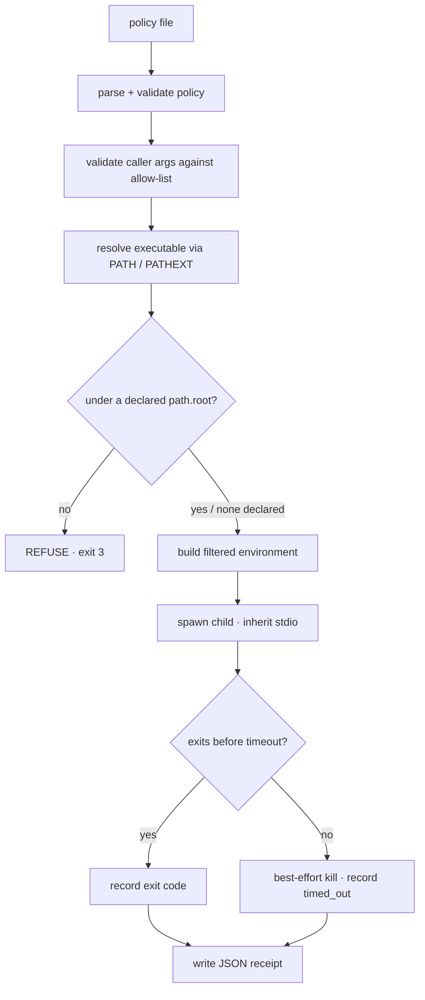

<!-- PALISADE — FORTRESS OPERATIONS HANDBOOK -->

<div align="center">



# Palisade — Fortress Operations Handbook

**A cross-platform, userspace declarative command policy launcher.**
*You post the standing orders once; the gatehouse enforces them the same way, everywhere.*

</div>

> [!WARNING]
> **This is a gatehouse, not a dungeon.** Palisade is a **userspace launcher, not a kernel
> sandbox.** It decides *whether and how* a command is launched. It does **not** confine a
> process once running. Read [§7 · The Threat Boundary](#7--the-threat-boundary) first.

---

## How to read this handbook

Not a feature brochure — a duty roster, written the way you would brief an operator taking a
shift at the gate. Read in order the first time; return by number afterwards.

**Posts:**
[1 Operator Briefing](#1--operator-briefing) ·
[2 Muster](#2--muster--build-and-install) ·
[3 The Two Wardens](#3--the-two-wardens) ·
[4 Standing Orders](#4--reading-standing-orders--policy-anatomy) ·
[5 Admission Sequence](#5--the-admission-sequence) ·
[6 Seal of Record](#6--the-seal-of-record--receipts) ·
[7 Threat Boundary](#7--the-threat-boundary) ·
[8 Field Transcripts](#8--field-transcripts) ·
[9 Armoury](#9--recipes-from-the-armoury) ·
[10 Failure Diagnosis](#10--failure-diagnosis) ·
[11 Cross-Platform](#11--cross-platform-notes) ·
[12 Limitations & Roadmap](#12--limitations--roadmap)

---

## 1 · Operator Briefing

Ad-hoc command invocation is where accidents live. A wrapper script leaks the full
environment to a subprocess. A CI step quietly accepts an extra `--force`. A cron job with
no timeout hangs a runner. Each is an *implicit* assumption nobody reviewed.

Palisade turns those assumptions into a **standing order** — a small, auditable policy file
that describes exactly how one command may run: its **executable** (a bare name via `PATH`,
or an explicit path); its **arguments** (a fixed prefix plus an allow-list of what a caller
may add); its **environment** (started clean and populated, or inherited and pruned); an
optional **path constraint** on which binary launches; a declared **network intent**
(advisory — see [§7](#7--the-threat-boundary)); and a wall-clock **timeout**.

The launcher then resolves the executable, filters the environment, validates the arguments,
spawns the process, enforces the timeout, and writes a machine-readable **receipt** of what
actually happened. Lint the file, diff it in review, and run it identically on a laptop, a CI
runner, and a cron host.

Use Palisade to make command execution **explicit, consistent, and auditable** — in CI
wrappers, cron jobs, and operator runbooks. Do **not** use it as a barrier against hostile
code. For real isolation, station the gatehouse *inside* a container, VM, or OS sandbox.

---

## 2 · Muster — build and install

Two tools garrison the fortress, built from two toolchains — both **standard-library only**,
no third-party dependencies. **Prerequisites:** Rust (1.74+) and Go (1.24+).

```sh
# The launcher (Rust) — the tool that executes.
cd launcher && cargo build --release        # -> launcher/target/release/palisade

# The inspector (Go) — the tool that only reads.
cd inspector && go build ./cmd/palisade-lint # -> palisade-lint(.exe)
```

Or muster both at once through the top-level [`Makefile`](Makefile):
`make build` (compile both), `make test` (cargo test + go test), `make lint-examples`,
`make fmt`, `make vet`.

---

## 3 · The two wardens

One fortress format; two independently-written tools that must agree on it. The grammar is
implemented **twice** — once in Rust, once in Go — and cross-checked by each tool's tests.

| Warden | Language | Standing duty | Executes? |
|--------|----------|---------------|:---------:|
| [`palisade`](launcher/) | Rust (stdlib) | Loads + validates a policy, resolves the program, **runs** it, writes a receipt. | **Yes** |
| [`palisade-lint`](inspector/) | Go (stdlib) | **Inspects and lints** the same format. Reads files, reports diagnostics. | **Never** |

The division is deliberate. The **inspector never launches a process** — run it safely
against an untrusted policy to learn what it *would* do. The **launcher** is the only tool
with the keys to the gate. Both read the same normative grammar in
[`docs/POLICY.md`](docs/POLICY.md).

---

## 4 · Reading standing orders — policy anatomy

A policy is a tiny INI-like text file. `=` sets a **scalar** (last assignment wins); `+=`
**appends** to a **list** (order preserved). There is no quoting, escaping, or line
continuation — deliberately, so the format is trivial to parse, diff, and audit. A `#`
anywhere on a line begins a comment.

Here is a complete standing order, annotated post by post:

```ini
name = git-status              # human-readable label (default: "unnamed")

[exec]
program = git                  # REQUIRED. Bare name (PATH-resolved) or a path.
timeout_ms = 10000             # wall-clock ms. 0/absent = no timeout.
# workdir = /srv/repo          # optional working directory

[args]
fixed = status                 # always prepended, in order
fixed += --short               # (+= preserves order)
allow_extra = false            # false (default): only allow-listed caller args
# allow = --porcelain          # allow-list of extra caller args

[env]
mode = inherit                 # "clean" (default) or "inherit"
remove = AWS_SECRET_ACCESS_KEY # (inherit) prune from parent env
remove += GITHUB_TOKEN
# pass = HOME                  # (clean) copy from parent if present
# set = LANG=C.UTF-8           # KEY=VALUE applied LAST, overriding above

[path]
# root = /usr/bin              # if set, resolved binary MUST live under a root

[net]
mode = none                    # "none" (default) or "allow". ADVISORY ONLY — see §7.
```

### The section register

Full per-key detail is in the normative spec [`docs/POLICY.md`](docs/POLICY.md). In brief:
`exec.program` is the only **required** key; `args` splits into a `fixed` prefix and an
`allow` list gated by `allow_extra`; `env` is either `clean` (empty + `pass` + `set`) or
`inherit` (parent − `remove` + `set`); `path.root` optionally confines the resolved binary;
`net.mode` is `none`/`allow` and **advisory only**. Booleans accept `true/yes/1/on` and
`false/no/0/off`, case-insensitive.

---

## 5 · The admission sequence

When you run `palisade run`, a command approaches the gate and must clear five wardens in
order. Any refusal halts admission with a distinct exit code (see [§10](#10--failure-diagnosis)).



### 5.1 Argument validation

With `allow_extra = false` (default), every caller argument must appear **verbatim** in
`args.allow`, or the launcher refuses. The final argument vector is `args.fixed` followed by
the validated caller arguments. With `allow_extra = true` the allow-list is *ignored* and any
argument is accepted (the linter warns — see [§10](#10--failure-diagnosis)).

### 5.2 Executable resolution

- If `program` contains a path separator (`/` anywhere, `\` on Windows), it is used as a
  **path** directly (canonicalized to absolute where possible).
- Otherwise it is a **bare name** resolved against `PATH`. On Windows `PATHEXT` is honored, so
  `git` finds `git.exe`; if unset, a `.com/.exe/.bat/.cmd` fallback applies.
- If any `path.root` is declared, the resolved absolute path must sit within a root or the
  launch is refused (paths canonicalized for a robust prefix check). `path.root` constrains
  **which binary is launched** — never what the running process may later touch.

### 5.3 Environment resolution

Built deterministically, then **sorted by key** before the child receives it (so execution
and the receipt are reproducible):

- **`clean`** *(default)* — empty environment; copy each `env.pass` name present in the parent;
  then apply `env.set`.
- **`inherit`** — full parent environment; delete each `env.remove` name; then apply `env.set`.

In both modes `env.set` (`KEY=VALUE`) is applied **last** and wins.

### 5.4 Timeout behaviour

Enforcement is portable and stdlib-only: spawn the child, then poll its status until it exits
or the deadline passes; on timeout, issue a **best-effort kill** and reap it, recording
`timed_out`. The poll interval scales with the timeout, clamped to **[5 ms, 100 ms]**.
`timeout_ms = 0` (or absent) disables the timer. A timeout maps to exit code **124**, matching
GNU `timeout`.

---

## 6 · The seal of record — receipts

<div align="center">

</div>

Every `palisade run` inscribes a **receipt**: a single-line JSON record of what was launched
and how it ended. Write it with `--receipt <FILE>`; omit the flag and it prints to **stderr**.

```json
{"policy_name":"git-status","program":"git","resolved_path":"/usr/bin/git",
 "args":["status","--short"],"env_mode":"inherit",
 "effective_env_keys":["HOME","PATH", ...],"net_declared":"none",
 "timeout_ms":10000,"duration_ms":42,"outcome":"exited","exit_code":0}
```

What the seal records: `policy_name`, `program`, `resolved_path` (the exact binary chosen);
`args` (final vector = `fixed` + validated extras); `env_mode` and `effective_env_keys` (the
mode and the **sorted list of variable *names***); `net_declared` (the *declared* intent,
a label not a control); `timeout_ms` and `duration_ms`; and `outcome` — `exited` (with an
`exit_code`, possibly `null`) or `timed_out`.

> [!IMPORTANT]
> The receipt records environment **key names, never values.** A secret's *presence* may be
> visible; its *contents* are never written. `net_declared` records what the policy claimed,
> not what the process did on the wire.

---

## 7 · The threat boundary

This is the most important post in the handbook. Read it before trusting the gate.

**Palisade is a userspace launcher, not a sandbox.** It provides **no** OS-kernel isolation
and uses **no** seccomp, Linux namespaces, cgroups, ptrace, Windows job objects, or
AppContainer. Concretely:

- **`net.mode = none` does not block network access.** It records a *declaration* of intent
  that both tools surface and that lands in the receipt; a launched program can still open
  sockets freely — the linter says so itself (`P200`).
- **`path.root` constrains which executable is launched**, not what the running process may
  later read, write, or connect to.
- **Argument and environment filtering reduce *accidental* exposure** — a stray `--force`, a
  leaked `AWS_SECRET_ACCESS_KEY` — but do **not** contain a hostile binary. Once running, a
  process runs with your privileges.

The gate decides *who gets in and how they are dressed*; it does not follow them inside. For
real isolation against untrusted code, run Palisade **inside** a container, VM, or OS sandbox,
and treat that outer layer as the actual security boundary.

---

